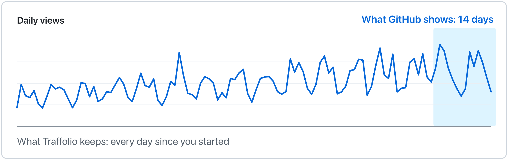
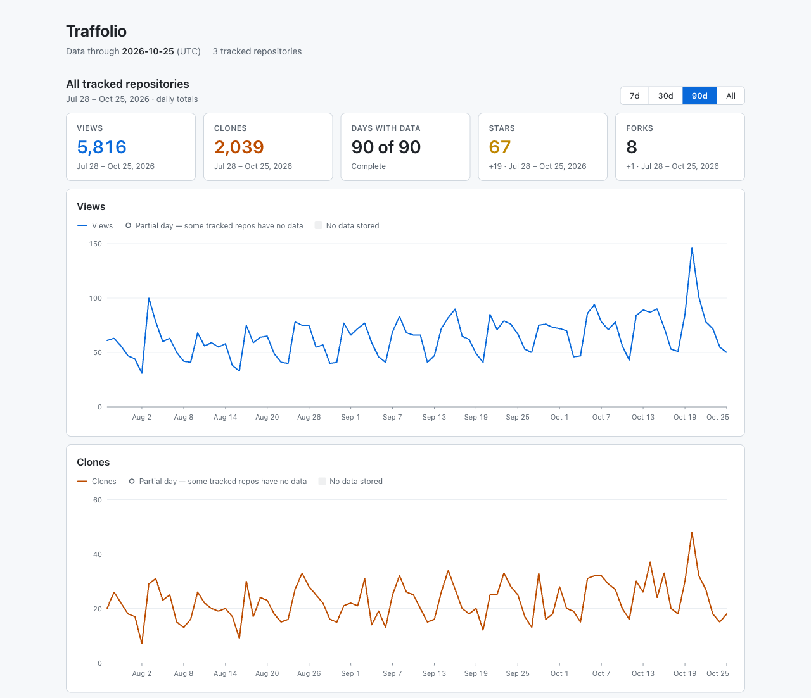

# Traffolio

> **Your GitHub traffic history, stored in your own repository.**  
> **No server. No database. Just GitHub.**

GitHub's Traffic API only returns the last 14 days of views and clones. Traffolio runs on GitHub Actions, collects views and clones for your repositories every day, and stores the history as JSON in your own **private** repository, with a dashboard rendered right here in this README.

<picture>
  <source media="(prefers-color-scheme: dark)" srcset="docs/hero-dark.png">
  
</picture>

<!-- TRAFFOLIO:START -->
**No traffic data collected yet.** After the first collection run, this block is replaced with your own numbers. See [Setup](#setup).

Live example: daily traffic of [zeikar/traffolio](https://github.com/zeikar/traffolio), collected by Traffolio in public mode in [zeikar/traffolio-demo](https://github.com/zeikar/traffolio-demo).


[See a full sample section (sample data)](docs/demo/README-section.md)
<!-- TRAFFOLIO:END -->

## What it is, and what it is not

Traffolio is an open-source GitHub template. You create your own private copy, register one token, and a daily workflow keeps a long-term, per-day history of **Views** and **Clones** for the repositories your personal account owns, so you can compare them in one place.

It is not:

- a SaaS, backend, hosted database, or anything outside your GitHub account (no sign-up, billing, or Traffolio account);
- a real-time tracker, a visitor identity tracker, or a per-visit log. It is a **daily** history;
- a way to recover data older than 14 days that GitHub never gave you;
- a tool for other people's or organizations' repositories. Only repositories owned by the token's personal account are collected;
- a public dashboard by default. A public Traffolio repository is refused unless you opt in with `public_mode: true` to publish the numbers on purpose (see [Public mode](#public-mode)).

## How it works

1. A scheduled GitHub Actions workflow (`.github/workflows/collect.yml`) runs once a day. You can also run it manually.
2. It lists your owned repositories, applies the filters in `traffolio.config.yml`, and fetches the latest 14 days of daily views and clones for each one.
3. The results are merged into JSON files under `data/`. Each day is overwritten (upserted) by repository ID and UTC date, so re-running never double-counts.
4. For the same repositories it also records star and fork history, a snapshot of the top referrers and popular pages, and release download counts (see [Data](docs/data.md)). These extras run after the traffic and never change how the traffic part of the run is judged.
5. The README dashboard (between the `TRAFFOLIO` markers), `assets/views.svg`, `assets/clones.svg`, the trend images in `assets/sparklines/`, and one page per repository in `repos/<repo_id>.md` with its charts in `assets/repos/<repo_id>/` are regenerated from that JSON. Only that marked block is rewritten; the rest of this README is yours. Keep exactly one `TRAFFOLIO:START` and one `TRAFFOLIO:END` marker comment, in that order (writing either marker out in full anywhere else in this README, even in a code span, counts as a second copy): otherwise the run stops before collecting and writes nothing (see [Troubleshooting](docs/operations.md#troubleshooting)).
6. If any file changed, the workflow commits it with `GITHUB_TOKEN`. If nothing changed, there is no commit.

## Setup

1. On the Traffolio template repository, click **Use this template**.
2. Create the new repository under your personal account and set it to **Private**. A public Traffolio repository is refused unless `public_mode: true` (see [Public mode](#public-mode)).
3. Review `traffolio.config.yml` (see [Configuration](#configuration)). The default is `include_private: false`.
4. Create a fine-grained personal access token (GitHub Settings → Developer settings → Personal access tokens → Fine-grained tokens):
   - Resource owner: your own GitHub account
   - Repository access: **All repositories**, or only the repositories you pick (then only those can be collected)
   - Repository permissions: **Administration: Read-only** (Metadata: Read is included automatically)
   - Optional: **Contents: Read-only**, only needed for release downloads of private repositories (when `include_private: true`). Public repositories' releases are readable without it.
5. In your new Traffolio repository, add the token as the Actions secret **`TRAFFIC_TOKEN`** (Settings → Secrets and variables → Actions).
6. Enable Actions for the repository if needed, then run the workflow manually: Actions → **Traffolio Collect** → **Run workflow** (`workflow_dispatch`).
7. Open the run's Summary to check the result, then confirm the README dashboard above was updated.

Why the token needs Administration: Read, and every API call Traffolio makes: [Security and permissions](docs/security.md#why-administration-read).

Secrets are not copied when a repository is created from a template. The scheduled workflow can run before you add `TRAFFIC_TOKEN`; that run fails with a message saying `TRAFFIC_TOKEN` is not registered, which is expected until step 5 is done.

## Local dashboard

The README shows a summary. For a daily Views chart and a daily Clones chart (with unique visitors and cloners when one repository is selected), period switching (7 / 30 / 90 days / all) and sorting, generate a local dashboard from a clone of your Traffolio repository:



*Shown with sample data. The same dashboard is [live for the demo instance](https://zeikar.dev/traffolio-demo/), published with [GitHub Pages](docs/public-mode.md#github-pages-dashboard).*

```sh
git clone <your Traffolio repository> && cd <it>
npm install
npm run dashboard   # writes dashboard.html and prints its file:// URL
```

Options go after `--`, for example `npm run dashboard -- --out ~/traffic.html`:

- `--data <dir>`: the Traffolio repository to read, the directory that contains `data/` (default: the current directory)
- `--out <file>`: where to write the page (default: `dashboard.html` in that directory)
- `--public`: build the published variant, without the local path; refused if `data/index.json` lists a private repository (see [GitHub Pages dashboard](docs/public-mode.md#github-pages-dashboard))

It also shows star history (cumulative stars and new stars per period), the latest top referrers and pages, and release downloads per release with a daily-downloads chart; `#repo=<repo_id>` at the end of the file URL opens one repository directly.

It is a single HTML file with no external resources, so the data never leaves your machine. Don't publish it with GitHub Pages from a private Traffolio repository: on a personal account a Pages site is always public, even from a private repository. A public-mode repository can publish the same dashboard; see [GitHub Pages dashboard](docs/public-mode.md#github-pages-dashboard). `dashboard.html` is git-ignored because it contains your traffic data; don't commit or publish it.

## Security

- **Keep this repository private.** Traffic numbers and the whole Git history become public the moment it isn't. For a public dashboard, create a separate repository with `public_mode: true` ([Public mode](#public-mode)).
- The token lives only in Actions Secrets and never appears in data files, logs, the run Summary or the charts.
- **Fail closed.** If the repository is public without `public_mode: true`, or its visibility can't be determined, nothing is collected or committed.

What every failure looks like, and the permissions in detail: [Security and permissions](docs/security.md).

## Public mode

`public_mode: true` lets a **public** Traffolio repository publish the traffic of selected public repositories on purpose, for example as a demo; its charts can be [embedded in other READMEs](docs/public-mode.md#embed-a-chart-in-another-readme), and with `pages: true` it also publishes the dashboard to GitHub Pages. Private repositories are never selected, and everything it produces, including Actions logs, is public. Read [Public mode](docs/public-mode.md) before turning it on.

## Configuration

`traffolio.config.yml` has a `repositories` section and top-level `public_mode` and `pages` switches. Unknown keys and wrong types are rejected with an error, and a missing key uses its default.

| Key | Default | Meaning |
|---|---|---|
| `include` | `["*"]` | Glob patterns; a repository must match at least one |
| `exclude` | `[]` (the shipped file sets `["test-*", "playground-*"]`) | Glob patterns; any match removes the repository. Exclude always wins over include |
| `include_private` | `false` | Also collect private repositories |
| `include_forks` | `false` | Also collect forks |
| `include_archived` | `false` | Also collect archived repositories |
| `include_self` | `false` | Also collect the Traffolio repository itself. Still requires `include_private: true`, since Traffolio is private (except in public mode) |
| `public_mode` (top level) | `false` | Allow a public Traffolio repository to collect and publish the selected repositories' numbers; see [Public mode](#public-mode). In a public repository, cannot be combined with `include_private: true` |
| `pages` (top level) | `false` | Publish the dashboard to GitHub Pages on each run. Only takes effect in a public repository with `public_mode: true`; see [GitHub Pages dashboard](docs/public-mode.md#github-pages-dashboard) |

Matching rules:

- Patterns are globs matched against the repository **name** only (no owner), matching is case-insensitive, and dot-prefixed names like `.github` match `*`.
- Traffolio itself is recognized by its repository ID (from `GITHUB_REPOSITORY`), not by name.
- Only repositories owned by the token's account are candidates; repositories you merely contribute to are ignored.

## Updating Traffolio

Merge the latest Traffolio into your repository, keeping your own config, README, data and charts:

```bash
git remote add traffolio https://github.com/zeikar/traffolio   # skip if already added
git fetch traffolio
git merge --no-commit --no-ff traffolio/main
(for p in traffolio.config.yml README.md data assets repos; do if git cat-file -e "HEAD:$p" 2>/dev/null; then git checkout HEAD -- "$p" || exit 1; fi; done) && git commit -m "Update Traffolio" && git push
```

A repository made from the template shares no history with Traffolio until its first update. For that one, in place of the merge line, run these two, which replace your files with Traffolio's before the line after them restores your own. Commit or stash your changes first: unlike a merge, they overwrite uncommitted work without asking.

```bash
git merge --no-commit --allow-unrelated-histories -s ours traffolio/main
git read-tree -u --reset traffolio/main
```

Before committing, `git status` shows what they delete: files Traffolio no longer has, and any you added yourself, which `git checkout HEAD -- <file>` keeps. New settings come with defaults; if a release renames or removes one you set, the collector stops with a config error naming it.

## Documentation

- [Data](docs/data.md): the files in `data/`, and how present, missing and not-yet-tracked days are counted
- [Security and permissions](docs/security.md): failure behavior, token permissions, the API calls made
- [Public mode](docs/public-mode.md): publishing selected repositories, embedding their charts, and the GitHub Pages dashboard
- [Operations](docs/operations.md): schedule, token expiry, running a collection locally, troubleshooting
- [GitHub API notes](docs/github-api-notes.md): API behavior measured while building Traffolio

## Contributing

See [CONTRIBUTING.md](CONTRIBUTING.md); changes are listed in [CHANGELOG.md](CHANGELOG.md).

## License

See [LICENSE](LICENSE).
