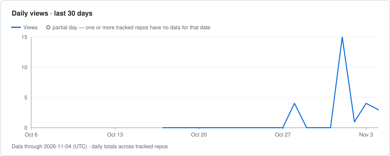
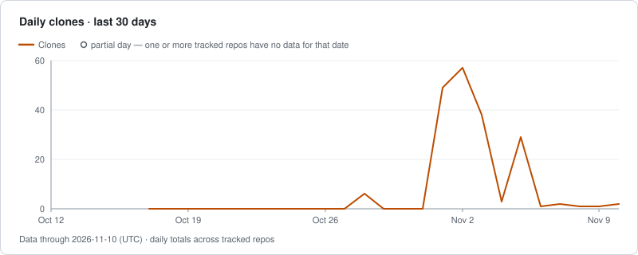

# Traffolio demo

Live, daily traffic of [zeikar/traffolio](https://github.com/zeikar/traffolio), collected by Traffolio itself.

This repository is an ordinary instance of the Traffolio template, configured with `public_mode: true` and `include: ["traffolio"]`, so it publishes the numbers for that one repository only. Everything between the markers below is regenerated by the daily workflow.

<!-- TRAFFOLIO:START -->
### Traffic — Data through 2026-11-09 (UTC)

| | 7d | 30d | All |
| --- | ---: | ---: | ---: |
| Views | 16 | 36 | 36 |
| Clones | 75 | 187 | 187 |

| Repository | Views trend (30d) | Visibility | Views 7d | Views 30d | Clones 7d | Clones 30d | Stars | Forks | Status |
| --- | --- | --- | ---: | ---: | ---: | ---: | ---: | ---: | --- |
| [zeikar/traffolio](repos/1436712184.md) · [GitHub](https://github.com/zeikar/traffolio) |  | public | 16 | 36 | 75 | 187 | 1 | 0 | ok |

#### Top referrers (last 14 days as of 2026-11-10, UTC)

| Referrer | Views from referrer |
| --- | ---: |
| github.com | 25 |

Summed over the tracked repositories; GitHub reports only each repository's top 10 referrers.

All dates and windows are UTC.  
Totals are event counts (views and clones), not unique users.
<!-- TRAFFOLIO:END -->

To track your own repositories privately, create a **private** repository from the [Traffolio template](https://github.com/zeikar/traffolio) instead.
