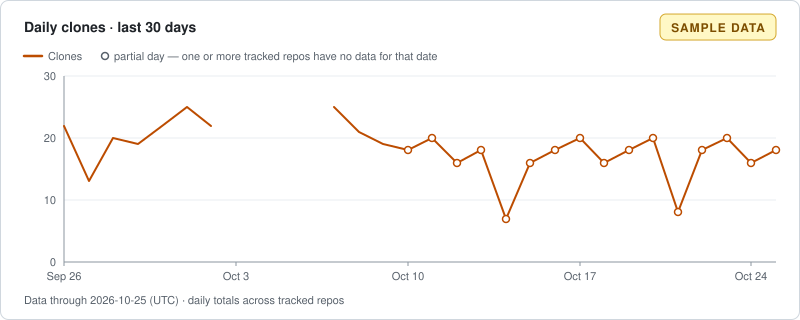

### Traffic — Data through 2026-10-25 (UTC)

*Sample data*

| | 7d | 30d | All |
| --- | ---: | ---: | ---: |
| Views | 380* | 1592* | 2086* |
| Clones | 118* | 475* | 610* |

| Repository | Views trend (30d) | Visibility | Views 7d | Views 30d | Clones 7d | Clones 30d | Stars | Forks | Status |
| --- | --- | --- | ---: | ---: | ---: | ---: | ---: | ---: | --- |
| [octo-sample/sample-cli](repos/100001.md) · [GitHub](https://github.com/octo-sample/sample-cli) |  | public | 231 | 878* | 75 | 250* | 42 | 5 | ok |
| [octo-sample/Sample-Docs](repos/100003.md) · [GitHub](https://github.com/octo-sample/Sample-Docs) |  | public | — | 135* | — | 49* | 8 | 1 | forbidden since 2026-10-10 |
| [octo-sample/sample-web](repos/100002.md) · [GitHub](https://github.com/octo-sample/sample-web) |  | public | 149 | 579* | 43 | 176* | 17 | 2 | ok |

\* Includes days with no stored data, or where some repositories have none; the sum covers only the data we have.

1 repository could not be collected (see data/status.json)

#### Top referrers (last 14 days as of 2026-10-27, UTC)

| Referrer | Views from referrer |
| --- | ---: |
| github.com | 54 |
| Google | 22 |
| news.ycombinator.com | 9 |
| dev.to | 5 |
| reddit.com | 5 |

Summed over the tracked repositories; GitHub reports only each repository's top 10 referrers.

All dates and windows are UTC.  
Totals are event counts (views and clones), not unique users.
