# octo-sample/sample-cli

[GitHub](https://github.com/octo-sample/sample-cli) · public · Status: ok · Data through 2026-10-25 (UTC)

*Sample data*

| | 7d | 30d | 90d | All |
| --- | ---: | ---: | ---: | ---: |
| Views | 231 | 878* | 1095* | 1095* |
| Clones | 75 | 250* | 313* | 313* |

\* Includes days with no stored data; the sum covers only the data we have.

## Views

## Clones

## Stars and forks

| | 7d | 30d | 90d | All |
| --- | ---: | ---: | ---: | ---: |
| New stars | 3 | 4 | 12 | 42 |
| New forks | 0 | 0 | 1 | 5 |

## Top referrers and pages (last 14 days as of 2026-10-27, UTC)

| Referrer | Views | Unique visitors |
| --- | ---: | ---: |
| github.com | 31 | 13 |
| Google | 13 | 9 |
| news.ycombinator.com | 6 | 3 |
| dev.to | 3 | 2 |
| reddit.com | 3 | 1 |
| duckduckgo.com | 2 | 1 |
| Bing | 1 | 1 |

| Page | Title | Views | Unique visitors |
| --- | --- | ---: | ---: |
| /octo-sample/sample-cli | octo-sample/sample-cli | 46 | 32 |
| /octo-sample/sample-cli/releases | Releases · octo-sample/sample-cli | 11 | 4 |
| /octo-sample/sample-cli/blob/main/README.md | sample-cli/README.md at main | 5 | 3 |
| /octo-sample/sample-cli/issues | Issues · octo-sample/sample-cli | 5 | 3 |

## Release downloads (as of 2026-10-27)

| Release | Published | Downloads | Change since 2026-09-22 |
| --- | --- | ---: | ---: |
| v2.1.0-beta.1 — v2.1.0 beta 1 | 2026-10-20 | 15 | 15 |
| v2.0.0 — Sample CLI 2.0 | 2026-08-03 | 161 | 53 |
| v1.0.0 | 2025-04-01 | 220 | 7 |

All dates and windows are UTC.  
Daily unique counts are per day and are never summed.
