# octo-sample/sample-web

[GitHub](https://github.com/octo-sample/sample-web) · public · Status: ok · Data through 2026-10-25 (UTC)

*Sample data*

| | 7d | 30d | 90d | All |
| --- | ---: | ---: | ---: | ---: |
| Views | 149 | 579* | 746* | 746* |
| Clones | 43 | 176* | 215* | 215* |

\* Includes days with no stored data; the sum covers only the data we have.

## Views

## Clones

## Stars and forks

| | 7d | 30d | 90d | All |
| --- | ---: | ---: | ---: | ---: |
| New stars | 0 | 0 | 2 | 17 |
| New forks | 0 | 0 | 0 | 2 |

## Top referrers and pages (last 14 days as of 2026-10-27, UTC)

| Referrer | Views | Unique visitors |
| --- | ---: | ---: |
| github.com | 23 | 18 |
| Google | 9 | 6 |
| news.ycombinator.com | 3 | 1 |
| dev.to | 2 | 1 |
| reddit.com | 2 | 2 |

| Page | Title | Views | Unique visitors |
| --- | --- | ---: | ---: |
| /octo-sample/sample-web | octo-sample/sample-web | 29 | 17 |
| /octo-sample/sample-web/releases | Releases · octo-sample/sample-web | 10 | 6 |
| /octo-sample/sample-web/issues | Issues · octo-sample/sample-web | 4 | 2 |
| /octo-sample/sample-web/blob/main/README.md | sample-web/README.md at main | 2 | 1 |

All dates and windows are UTC.  
Daily unique counts are per day and are never summed.
