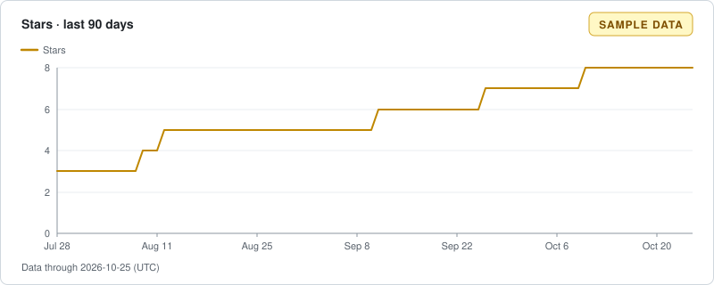

# octo-sample/Sample-Docs

[GitHub](https://github.com/octo-sample/Sample-Docs) · public · Status: forbidden since 2026-10-10 · Data through 2026-10-25 (UTC)

*Sample data*

| | 7d | 30d | 90d | All |
| --- | ---: | ---: | ---: | ---: |
| Views | — | 135* | 245* | 245* |
| Clones | — | 49* | 82* | 82* |

\* Includes days with no stored data; the sum covers only the data we have.

## Views

## Clones

## Stars and forks

| | 7d | 30d | 90d | All |
| --- | ---: | ---: | ---: | ---: |
| New stars | 0 | 2 | 5 | 8 |
| New forks | 0 | 0 | 0 | 1 |

## Top referrers and pages (last 14 days as of 2026-10-06, UTC)

| Referrer | Views | Unique visitors |
| --- | ---: | ---: |
| github.com | 11 | 7 |
| Google | 4 | 3 |
| news.ycombinator.com | 2 | 1 |

| Page | Title | Views | Unique visitors |
| --- | --- | ---: | ---: |
| /octo-sample/Sample-Docs | octo-sample/Sample-Docs | 16 | 11 |
| /octo-sample/Sample-Docs/releases | Releases · octo-sample/Sample-Docs | 5 | 3 |
| /octo-sample/Sample-Docs/blob/main/README.md | Sample-Docs/README.md at main | 2 | 1 |
| /octo-sample/Sample-Docs/issues | Issues · octo-sample/Sample-Docs | 2 | 1 |

All dates and windows are UTC.  
Daily unique counts are per day and are never summed.
