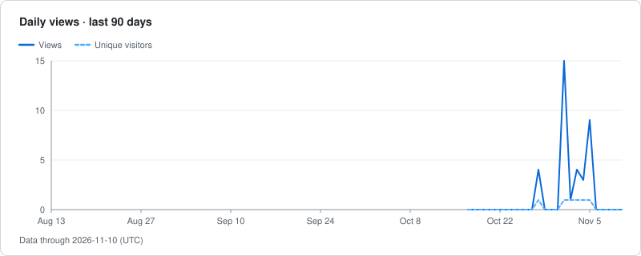
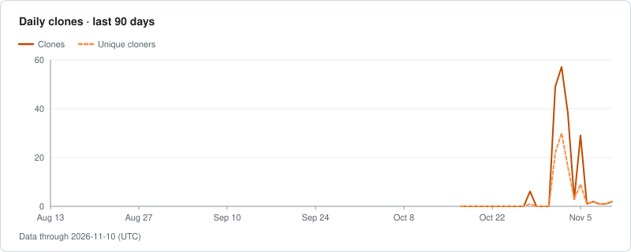
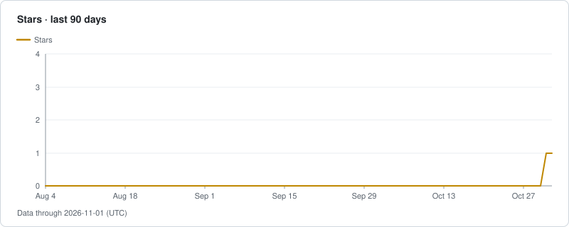

# zeikar/traffolio

[GitHub](https://github.com/zeikar/traffolio) · public · Status: ok · Data through 2026-11-03 (UTC)

| | 7d | 30d | 90d | All |
| --- | ---: | ---: | ---: | ---: |
| Views | 24 | 24 | 24 | 24 |
| Clones | 150 | 150 | 150 | 150 |

## Views

## Clones

## Stars and forks

| | 7d | 30d | 90d | All |
| --- | ---: | ---: | ---: | ---: |
| New stars | 1 | 1 | 1 | 1 |
| New forks | 0 | 0 | 0 | 0 |

## Top referrers and pages (last 14 days as of 2026-11-04, UTC)

| Referrer | Views | Unique visitors |
| --- | ---: | ---: |
| github.com | 16 | 1 |

| Page | Title | Views | Unique visitors |
| --- | --- | ---: | ---: |
| /zeikar/traffolio | Overview | 18 | 1 |
| /zeikar/traffolio/blob/main/docs/demo/README-section.md | /blob/main/docs/demo/README-section.md | 3 | 1 |
| /zeikar/traffolio/blob/main/Traffolio\_MVP.md | /blob/main/Traffolio\_MVP.md | 1 | 1 |
| /zeikar/traffolio/commits/main | /commits/main | 1 | 1 |

All dates and windows are UTC.  
Daily unique counts are per day and are never summed.
