# zeikar/traffolio

[GitHub](https://github.com/zeikar/traffolio) · public · Status: ok · Data through 2026-11-18 (UTC)

| | 7d | 30d | 90d | All |
| --- | ---: | ---: | ---: | ---: |
| Views | 1 | 40 | 40 | 40 |
| Clones | 20 | 213 | 213 | 213 |

## Views

## Clones

## Stars and forks

| | 7d | 30d | 90d | All |
| --- | ---: | ---: | ---: | ---: |
| New stars | 0 | 1 | 1 | 1 |
| New forks | 0 | 0 | 0 | 0 |

## Top referrers and pages (last 14 days as of 2026-11-19, UTC)

| Referrer | Views | Unique visitors |
| --- | ---: | ---: |
| github.com | 9 | 3 |

| Page | Title | Views | Unique visitors |
| --- | --- | ---: | ---: |
| /zeikar/traffolio | Overview | 9 | 4 |
| /zeikar/traffolio/actions | /actions | 1 | 1 |
| /zeikar/traffolio/actions/runs/42014574720 | /actions/runs/42014574720 | 1 | 1 |
| /zeikar/traffolio/actions/runs/42014574720/job/127201755336 | /actions/runs/42014574720/job/127201755336 | 1 | 1 |

All dates and windows are UTC.  
Daily unique counts are per day and are never summed.
